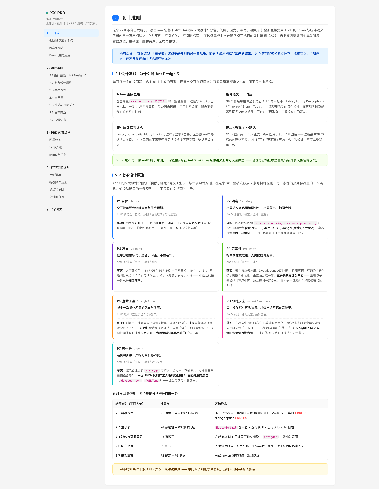
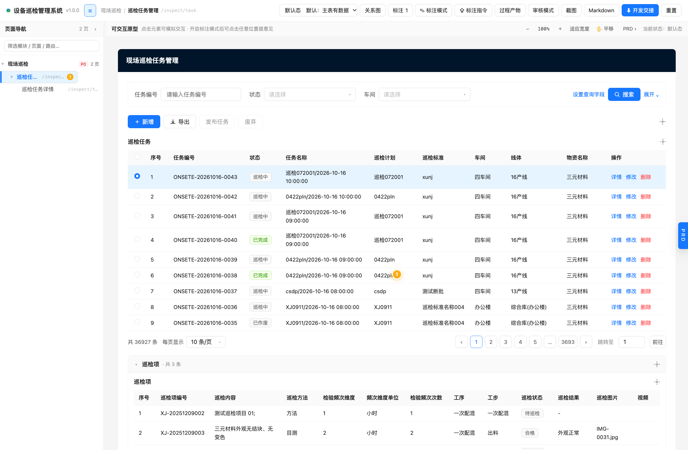

# XX-PRD

> **WorkBuddy 技能** —— 产品经理需求分析与原型设计工作台。
> 把「口头需求 / 一句话想法 / Vibe-Coding Demo」收敛成
> **可交互原型 + EARS 规范 PRD + 标注对齐** 三合一的单文件 HTML 容器，
> 基于 **Ant Design 5** 做设计，并产出可直接交给 AI 开工的开发交接包。



---

## 它能做什么

| 能力 | 说明 |
|---|---|
| **需求澄清** | 按 8 个维度逐轮提问（每轮 5~7 问），不猜需求 |
| **EARS 规范 PRD** | 12 章大纲，需求条目符合 EARS 句式与门禁（无主观词、可验收） |
| **可交互原型** | 组件树 + 交互 + 页面状态 + **主子表联动**，单文件、零依赖、离线可用 |
| **页面关系图** | 所有 `navigate` 自动抽成全局分层有向图 |
| **标注评审** | 原型上直接点位置加气泡提意见，可一键导出为「AI 修改指令」 |
| **开发交接包** | `devspec.json` + `AGENT.md`，机器可读，AI / 研发可直接开工 |

两个**必须人工确认**的卡点（确认需求 / 确认板块）—— 卡点未确认不往下走。



---

## 安装

### 方式 1 · 放进技能目录（最稳，任何版本都能用）

1. 下载本仓库（`Code → Download ZIP`）或 `git clone`
2. 把整个 `XX-PRD` 文件夹放到技能目录下：

   | 系统 | 路径 |
   |---|---|
   | macOS / Linux | `~/.workbuddy-ai/skills/` |
   | Windows | `C:\Users\<你的用户名>\.workbuddy-ai\skills\` |

3. 最终路径应该是 —— **`SKILL.md` 必须就在 `XX-PRD/` 这一层**：

   ```
   ~/.workbuddy-ai/skills/XX-PRD/SKILL.md
   ~/.workbuddy-ai/skills/XX-PRD/guide.html
   ~/.workbuddy-ai/skills/XX-PRD/references/
   ~/.workbuddy-ai/skills/XX-PRD/assets/
   ```

4. 重启 WorkBuddy，或直接新建一个任务

> ⚠️ 两个最常见的失败原因：
> ① 解压后多套了一层目录（变成 `skills/XX-PRD/XX-PRD/SKILL.md`）；
> ② 目录名被改掉（技能名由 frontmatter 的 `name: XX-PRD` 决定，目录名请保持一致）。

### 方式 2 · 让 WorkBuddy 自己装

新建任务 → 把仓库 zip 拖进对话框 → 说一句：

> 帮我安装这个技能包

### 方式 3 · URL 导入

在 WorkBuddy 的技能市场里用「URL 导入」，填本仓库地址：

```
https://github.com/jiujiume81/XX-PRD
```

---

## 使用

直接用自然语言说需求即可：

```
帮我写一个「设备巡检管理系统」的 PRD 和原型
把这份需求整理成 PRD
我有个 Demo，帮我逆向成需求文档
```

装好后也可以先打开 `guide.html` —— 那是技能的**自解释文档**，含工作流、设计准则、
PRD 内容结构、产物功能四块，看完就知道怎么用。

---

## 设计准则

这个技能不自己发明设计语言，而是**基于 Ant Design 5 做设计**（直接复用 AntD 的 token
与组件语义），并据此推导出 7 条可执行的设计原则：

| | 原则 | 来自 Ant Design |
|---|---|---|
| P1 | 自然 Nature | 价值观「自然」· 原则「提供邀请 / 巧用过渡」 |
| P2 | 确定 Certainty | 价值观「确定」· 原则「重复」 |
| P3 | 意义 Meaning | 价值观「意义」· 原则「对比」 |
| P4 | 亲密性 Proximity | 原则「亲密性 / 对齐」 |
| P5 | 直截了当 Straightforward | 原则「直截了当 / 足不出户」 |
| P6 | 即时反应 Feedback | 原则「即时反应 / 提供邀请」 |
| P7 | 可生长 Growth | 价值观「生长」· 原则「简化交互」 |

**容器选型**（对话框 / 抽屉 / 新页面）与**主子表**不是并列的另一套规矩，
而是 P5 + P6、P4 + P6 推导出来的结果 —— 所以它们能被校验器检查、能被容器运行期兜底。
完整推导见 [`guide.html`](guide.html) 第 2 章。

---

## 目录结构

```
XX-PRD/
├── SKILL.md                      技能主文件（工作流 / 关键约定 / 参考索引）
├── guide.html                    自解释说明指南（工作流 · 设计准则 · PRD 结构 · 产物功能）
├── references/                   8 份参考文档
│   ├── 01-clarification.md       澄清提问与 4 份 shaping 文档
│   ├── 02-ears-spec.md           EARS 句式与门禁
│   ├── 03-prd-structure.md       PRD 四层结构 + 12 章大纲
│   ├── 04-container-schema.md    数据契约（容器 Schema）
│   ├── 05-component-states.md    组件白名单 + 状态矩阵
│   ├── 06-demo-reverse.md        Demo 逆向三条抽取规则
│   ├── 07-quality-and-examples.md 验收标准与反例
│   └── 08-container-choice.md    容器选型准则
├── assets/
│   ├── container/index.html      交付容器本体（单文件、零依赖）
│   └── examples/                 4 个全链路示例 JSON
├── scripts/
│   └── validate_prd_json.py      结构校验器
└── docs/                         截图
```

---

## 交付物

| 产物 | 形式 | 说明 |
|---|---|---|
| 数据契约 | `XX-PRD.data.json` | 唯一真源，渲染 / 校验 / 导出都基于它 |
| 交付容器 | `XX-PRD.html` | **单文件**，双击即开，无需服务器、无需联网 |
| PRD 文档 | 容器内右栏 / 导出 `.md` | EARS 规范，含内嵌流程图 |
| 开发交接包 | `{产品}.devspec.json` + `AGENT.md` | 机器可读，供 AI / 研发直接开工 |

---

## 环境要求

- WorkBuddy（任意版本）
- 跑校验器需要 Python 3（可选，不跑也能用）
- 生成的 HTML 原型**零依赖**：不联网、不引 CDN、双击即开
