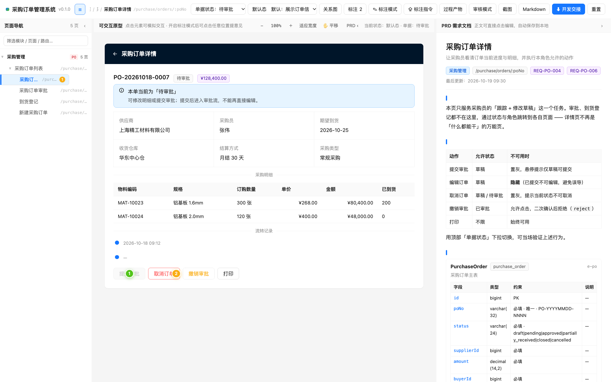

# XX-PRD

> **Agent Skill**：产品经理的需求分析与原型设计工作台。
> 它把口头需求、一句话想法或 Vibe-Coding Demo 收敛成三样东西：可交互原型、EARS 规范 PRD、标注对齐。
> 三者装进同一个单文件 HTML 容器，设计基线是 **Ant Design 5**。
> 产物里能直接带出交给 AI 开工的开发交接包。


---

## 它能做什么

| 能力 | 说明 |
|---|---|
| 需求澄清 | 按 9 个维度逐轮提问，每轮 5~7 问，不猜需求 |
| EARS 规范 PRD | 12 章大纲，需求条目符合 EARS 句式与门禁：无主观词、可验收 |
| 行为建模 | 先把谁 × 什么状态 × 能做什么定下来（`capabilities`），再决定按钮长什么样、功能要不要拆页 |
| 可交互原型 | 组件树、交互、页面状态、主子表联动、按单据状态变灰或隐藏的按钮；单文件、零依赖、离线可用 |
| 页面关系图 | 所有 `navigate` 自动抽成全局分层有向图 |
| 标注评审 | 在原型上点位置加气泡提意见，可一键导出为 AI 修改指令 |
| 切片交付 | 大需求按用户故事最小闭环切片，一轮一片，每片独立验收（`slices.json` + `prd_slice.py`） |
| 开发交接包 | `devspec.json` + `AGENT.md`，机器可读，AI 与研发可直接开工 |

两个**必须人工确认**的卡点：确认需求与命令策略、确认切片清单。卡点未确认不往下走，
`scripts/prd_flow.py` 会落盘校验，`guard build` / `guard export` 未过闸点直接返回非 0。


---

## 安装

本技能包遵循通用的 **Agent Skills** 约定：一个目录加一个 `SKILL.md`。
任何支持该约定的 AI 助手都能直接使用。

### 方式 1 · 放进 skills 目录（最稳）

1. 下载本仓库（`Code → Download ZIP`）或 `git clone`
2. 把整个 `XX-PRD` 文件夹放进你所用 AI 助手的 **skills 目录**（个人级）

   不同工具的目录位置不同，常见形态如下，具体以该工具文档为准：

   | 系统 | 示例（Claude Code） |
   |---|---|
   | macOS / Linux | `~/.claude/skills/` |
   | Windows | `C:\Users\<你的用户名>\.claude\skills\` |

   其他工具一般是 `~/.<工具名>/skills/`，或项目内的 `.<工具名>/skills/`。

3. 最终路径应该长这样，**`SKILL.md` 必须就在 `XX-PRD/` 这一层**：

   ```
   <skills 目录>/XX-PRD/SKILL.md
   <skills 目录>/XX-PRD/guide.html
   <skills 目录>/XX-PRD/references/
   <skills 目录>/XX-PRD/assets/
   ```

4. 重启你的 AI 助手，或直接新建一个会话

> ⚠️ 两个最常见的失败原因：
> ① 解压后多套了一层目录（变成 `skills/XX-PRD/XX-PRD/SKILL.md`）；
> ② 目录名被改掉。技能名由 frontmatter 的 `name: XX-PRD` 决定，目录名请保持一致。

### 方式 2 · 让 AI 助手自己装

新建会话 → 把仓库 zip 拖进对话框 → 说一句：

> 帮我安装这个技能包

### 方式 3 · URL 导入

在你的 AI 助手的技能市场 / 技能管理里用「URL 导入」，填本仓库地址：

```
https://github.com/jiujiume81/XX-PRD
```

---

## 使用

直接用自然语言说需求即可：

```
帮我写一个「设备巡检管理系统」的 PRD 和原型
把这份需求整理成 PRD
我有个 Demo，帮我逆向成需求文档
```

装好后也可以先打开 `guide.html`，那是本技能的自解释文档，含工作流、设计准则、
PRD 内容结构、产物功能四块，看完就知道怎么用。

---

## 为什么先做行为建模

多状态单据最容易出的两个错，根因是同一个：信息被拆开记录，没有连成语义链。
角色在 `users`、状态在 `stateMachines`、按钮在 `componentTree`，三者之间没有任何强制对应关系。
于是审批中的单据照样摆着一个能点的「提交审批」按钮；而页面只有一句 `goal`，
回答不了这几个表单为什么属于同一个页面。

所以本技能在需求分析与画页面之间插了一道行为建模，把散点连成一条链：

```
角色 → 业务任务 → 命令 → 前置条件（状态）→ 状态转移 → 页面职责 → 组件 → 验收
```

落到数据契约上是三样东西：

| 字段 | 回答什么问题 |
|---|---|
| `tasks[]` | 每个角色为了达成什么目标、要完成哪几件事 |
| `capabilities[]` | 谁（`actor`）在什么状态（`from`）下能对什么对象（`entity`）做什么；不可用时隐藏、置灰还是点了才拒（`policy`） |
| `pages[].contract` | 这一页拥有哪些命令（`owns`）、解决谁的什么决策（`decision`）、提交边界在哪（`submitBoundary`） |

有了这三样，原型里的业务按钮就不再写死 `disabled`，而是由角色和当前单据状态算出来。
容器顶栏的单据状态下拉一切换，该灰的灰、该消失的消失。右栏还会把 `capabilities` 渲染成一张
命令策略矩阵，行是命令、列是状态，点列头即可对照。



校验器同步升级为语义校验：状态机里每条人工转移必须有按钮入口（`system: true` 的自动流转除外）、
一条命令不能被两个页面同时 `owns`、验收条件要覆盖非法路径，否则直接报 ERROR。

> 上图即切换单据状态后的按钮置灰、隐藏与虚线警告效果。
> 想跑交互版：用容器加载 `assets/examples/example-05-behavior-model.json`（采购订单 · 6 个状态 · 4 个角色 · 10 条命令策略），
> 在顶栏切换单据状态，观察详情页与审批页的按钮变化。

---

## 设计准则

本技能不自己发明设计语言。颜色、间距、圆角、字号、组件形态全部直接复用 Ant Design 5 的 token
与组件语义，并据此推导出 7 条可执行的设计原则：

| | 原则 | 来自 Ant Design |
|---|---|---|
| P1 | 自然 Nature | 价值观「自然」· 原则「提供邀请 / 巧用过渡」 |
| P2 | 确定 Certainty | 价值观「确定」· 原则「重复」 |
| P3 | 意义 Meaning | 价值观「意义」· 原则「对比」 |
| P4 | 亲密性 Proximity | 原则「亲密性 / 对齐」 |
| P5 | 直截了当 Straightforward | 原则「直截了当 / 足不出户」 |
| P6 | 即时反应 Feedback | 原则「即时反应 / 提供邀请」 |
| P7 | 可生长 Growth | 价值观「生长」· 原则「简化交互」 |

**承载容器选型**（对话框 / 抽屉 / 新页面）与**主子表**并非独立规矩，
它们分别从 P5 + P6、P4 + P6 推导而来，所以能被校验器检查，也能被容器运行期兜底。
行为先于界面同理：按钮可用性是 P2「确定」与 P5「直截了当」在行为维度上的结果，跟审美无关。
完整推导见 [`guide.html`](guide.html) 第 2 章。

---

## 目录结构

```
XX-PRD/
├── SKILL.md                      技能主文件（工作流 / 关键约定 / 参考索引）
├── CHANGELOG.md                  版本变更记录（每条含 breaking 字段）
├── LICENSE                       MIT 许可
├── guide.html                    自解释说明指南（工作流 · 设计准则 · PRD 结构 · 产物功能）
├── references/                   11 份参考文档
│   ├── 01-clarification.md       澄清提问与 4 份 shaping 文档
│   ├── 02-ears-spec.md           EARS 句式与门禁
│   ├── 03-prd-structure.md       PRD 五层结构 + 12 章大纲
│   ├── 04-container-schema.md    数据契约（容器 Schema）
│   ├── 05-component-states.md    组件白名单 + 状态矩阵
│   ├── 06-demo-reverse.md        Demo 逆向三条抽取规则
│   ├── 07-quality-and-examples.md 验收标准与反例
│   ├── 08-container-choice.md    承载容器选型准则
│   ├── 09-behavior-model.md      行为建模（命令策略 / 状态 × 角色 × 动作）
│   ├── 10-page-decomposition.md  页面职责与功能切分（合并判据 / 拆分信号）
│   └── 11-slice-delivery.md      切片交付（用户故事最小闭环 / 单片上限 / 合并规则）
├── assets/
│   ├── container/index.html      交付容器本体（单文件、零依赖）
│   └── examples/                 5 个全链路示例 JSON
├── scripts/
│   ├── validate_prd_json.py      结构 + 语义校验器
│   ├── prd_flow.py               流程闸门（8 阶段 + 卡点 A/B 落盘校验）
│   └── prd_slice.py              切片计划校验 / 单片校验 / 合并 / 标记完成
└── docs/                         截图
```

---

## 交付物

| 产物 | 形式 | 说明 |
|---|---|---|
| 数据契约 | `XX-PRD.data.json` | 唯一真源，渲染、校验、导出都基于它 |
| 交付容器 | `XX-PRD.html` | **单文件**，双击即开，无需服务器、无需联网 |
| PRD 文档 | 容器内右栏 / 导出 `.md` | EARS 规范，含内嵌流程图 |
| 开发交接包 | `{产品}.devspec.json` + `AGENT.md` | 机器可读，供 AI 与研发直接开工 |

---

## 环境要求

- 支持 **Agent Skills** 约定的 AI 助手（一个目录加 `SKILL.md` 即可）
- 跑校验器需要 Python 3。这一步可选，不跑也能用
- 生成的 HTML 原型**零依赖**：不联网、不引 CDN、双击即开

---

## 许可

本项目以 **MIT License** 发布，全文见 [`LICENSE`](LICENSE)。可自由使用、修改、分发（含商用），
保留版权声明与许可声明即可。

版本变更与兼容性说明见 [`CHANGELOG.md`](CHANGELOG.md)，当前版本 0.5.1。
